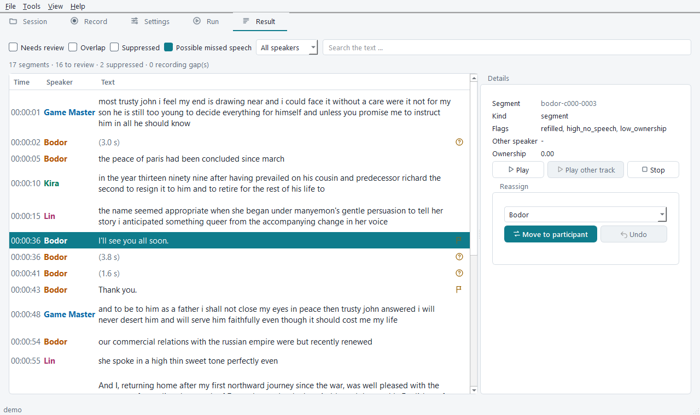
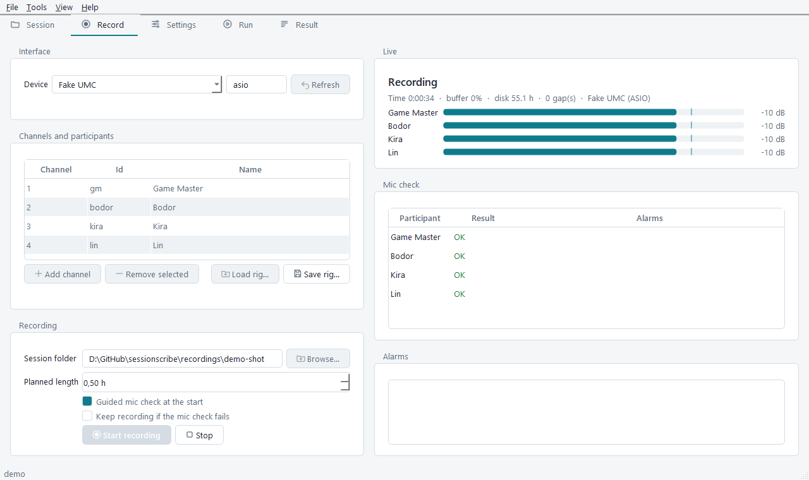

# SessionScribe

> Pre-release (0.x). Works end to end on the reference machine; defaults may still change
> before 0.1.0.

Local, multi-track speech-to-text built on [faster-whisper](https://github.com/SYSTRAN/faster-whisper).
Designed for tabletop RPG sessions recorded with one lavalier mic per participant
(up to 8 tracks, sessions up to 8 hours): each track is transcribed separately,
cross-track bleed is handled, and everything is merged into one speaker-labelled,
timestamped transcript (txt, srt, vtt, json, md).

- Runs fully offline after models are downloaded; nothing is sent to the cloud.
- Windows 10/11 and Linux; NVIDIA GPU (CUDA) recommended, CPU fallback.
- Hungarian and English are first-class; any Whisper language works.
- Records the session too: one multi-channel stream, guided mic check, alarms, crash-safe
  segmented files.
- Guiding principle: losing real speech is worse than showing a duplicate. Filters
  keep and flag when uncertain, and every removal is recorded with a reason.



## Magyar összefoglaló

A SessionScribe helyben futó, többsávos beszédfelismerő asztali szerepjáték-sessionökhöz.
Mindenkinek saját csiptetős mikrofonja van, a program sávonként ír át (faster-whisper),
kiszűri az áthallást, és egyetlen, beszélőnként címkézett, időbélyeges leiratot készít.
A modellek letöltése után teljesen offline működik; magyarul és angolul egyaránt jól.

1. **Telepítés:** Git és [uv](https://docs.astral.sh/uv/) kell, aztán
   `git clone https://github.com/htdlord/sessionscribe.git`, `cd sessionscribe`,
   `uv sync --locked --extra gui --extra cuda`, végül `uv run sessionscribe doctor`.
   Részletek: [docs/INSTALL.md](docs/INSTALL.md) (angolul).
2. **Kipróbálás felvétel nélkül:** `uv run sessionscribe demo`, majd
   `uv run sessionscribe transcribe --session demo` (kitalált szereplők, közkincs
   LibriVox-hangok; [docs/DEMO.md](docs/DEMO.md)).
3. **Felvétel → átírás → áttekintés:** a `uv run sessionscribe-gui` asztali alkalmazás
   Felvétel, Session, Beállítások, Futtatás és Eredmény fülein, vagy parancssorból (lent).
   A felület magyarul is elérhető (*Nézet → Nyelv*).
4. **Játéknapon:** [docs/SESSION_CHECKLIST_HU.md](docs/SESSION_CHECKLIST_HU.md) – rig,
   mikrofonpróba, riasztások, teendők hiba esetén, `record verify`.

A résztvevők hangja személyes adat: aki felvételt készít, annak a felelőssége a
résztvevők tájékoztatása és – ahol szükséges – a hozzájárulásuk beszerzése.

## Install

```bash
git clone https://github.com/htdlord/sessionscribe.git
cd sessionscribe
uv sync --locked --extra gui --extra cuda   # leave out cuda without an NVIDIA GPU
uv run sessionscribe doctor                 # versions, CUDA, a real short inference, audio
```

No CUDA Toolkit or cuDNN install is needed; the `cuda` extra brings them.
[docs/INSTALL.md](docs/INSTALL.md) covers prerequisites, audio interfaces, updating and
troubleshooting; [docs/SUPPORTED.md](docs/SUPPORTED.md) lists what has been tested.

## Quick start

Try it on the demo session (four fictional players, public-domain voices, simulated bleed):

```bash
uv run sessionscribe demo
uv run sessionscribe transcribe --session demo     # -> demo/output/
```

### Desktop app

```bash
uv run sessionscribe-gui
```



Tabs: **Session** (create from a folder or open `session.toml`, edit participants),
**Record** (device and rig, guided mic check, meters, alarms; the recording runs in a
separate process, so closing the window does not stop it and reopening reconnects),
**Settings** (preset, basic settings, generated advanced form; settings with no effect in
the chosen ASR mode are disabled), **Run** (progress, ETA, cancel; running again resumes
from the cache; export only), **Result** (filters, playback from the original track,
reassigning a segment to another participant without re-ASR). The interface is English
or Hungarian and follows the system light/dark theme unless set under *View*.

### Record a session

The device is always named explicitly; save it once in a rig file:

```bash
uv run sessionscribe record devices                                   # names, host APIs, channels
uv run sessionscribe record rig save rig.toml --device "UMC ASIO Driver" --host-api asio --channels 1-8 --names gm,anna,bela,... --labels "Mesélő,Anna,Béla,..."
uv run sessionscribe record meters --rig rig.toml                      # identify channels
uv run sessionscribe record start --rig rig.toml --session recordings/2026-11-05   # mic check first; Ctrl+C stops
uv run sessionscribe record verify --session recordings/2026-11-05
```

After a crash: `record recover --session ...`. The mic check's turns are saved for guided
bleed coupling.

### Transcribe

```bash
uv run sessionscribe session init recordings/2026-10-29/      # for files you recorded elsewhere
uv run sessionscribe transcribe --session recordings/2026-10-29 -l hu --formats json,txt,srt,vtt,md
uv run sessionscribe export --session recordings/2026-10-29   # after renaming / offsets: no ASR
uv run sessionscribe reassign --session recordings/2026-10-29 --segment p2-c004-0003 --to p5
uv run sessionscribe clean --session recordings/2026-10-29    # delete the work folder (cache)
```

Completed chunks are cached in `<session>/work/` (it contains transcript text), so an
interrupted run resumes and renaming or moving a participant only re-exports.

`quality` mode (the default) uses `WhisperModel.transcribe()` with temperature fallback;
`fast` mode uses the batched pipeline, which ignores some options (the CLI warns). Bleed
handling defaults to `post` (attribution after ASR, never re-transcribes); the `strong`
preset uses `pre` mode. Settings: `sessionscribe config show|init|validate`,
`sessionscribe presets list`; every command has `--help`.

## Documentation

- [docs/INSTALL.md](docs/INSTALL.md) – installation on Windows and Linux
- [docs/SUPPORTED.md](docs/SUPPORTED.md) – tested and expected configurations
- [docs/DEMO.md](docs/DEMO.md) – the demo session and its sources
- [docs/SESSION_CHECKLIST_HU.md](docs/SESSION_CHECKLIST_HU.md) – session-day checklist (Hungarian)
- [docs/SPEC.md](docs/SPEC.md), [docs/DECISIONS.md](docs/DECISIONS.md) – specification and decision log
- [docs/DEVELOPMENT.md](docs/DEVELOPMENT.md) – tests, benchmarks, translations, release checks
- [CHANGELOG.md](CHANGELOG.md)

## Privacy

Participants' voices are personal data. Whoever records a session is responsible
for informing participants and obtaining consent where required. Logs contain no
transcript text by default; the cache in `<session>/work/` does (`sessionscribe clean`).

## Licence

MIT – see [LICENSE](LICENSE). Third-party packages keep their own licences, listed in
[THIRD_PARTY_NOTICES.md](THIRD_PARTY_NOTICES.md) (PySide6/Qt: LGPLv3, installed as
replaceable libraries; NVIDIA libraries: installed from PyPI under NVIDIA's terms).
Whisper models are downloaded on first use; the demo voices are public-domain LibriVox
recordings ([docs/DEMO.md](docs/DEMO.md)).
